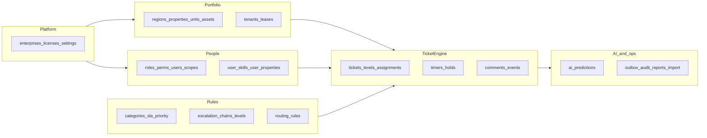
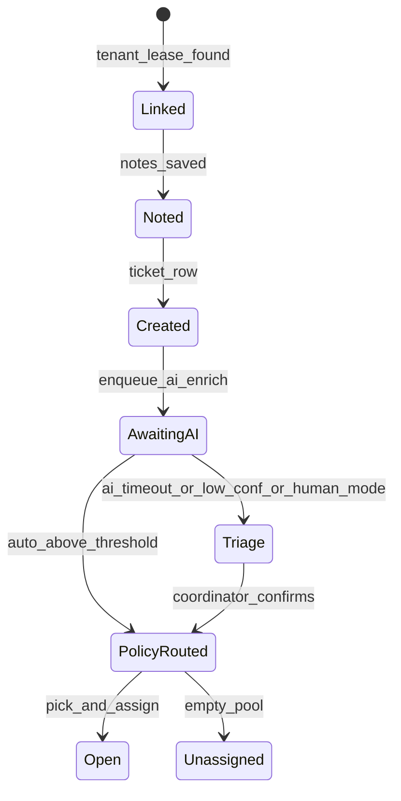
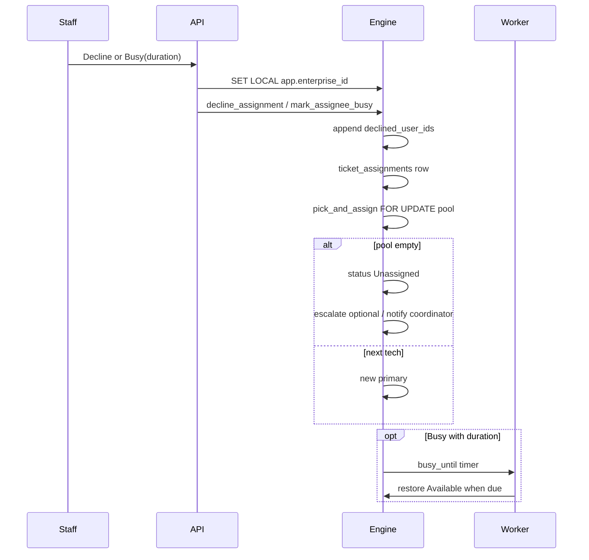
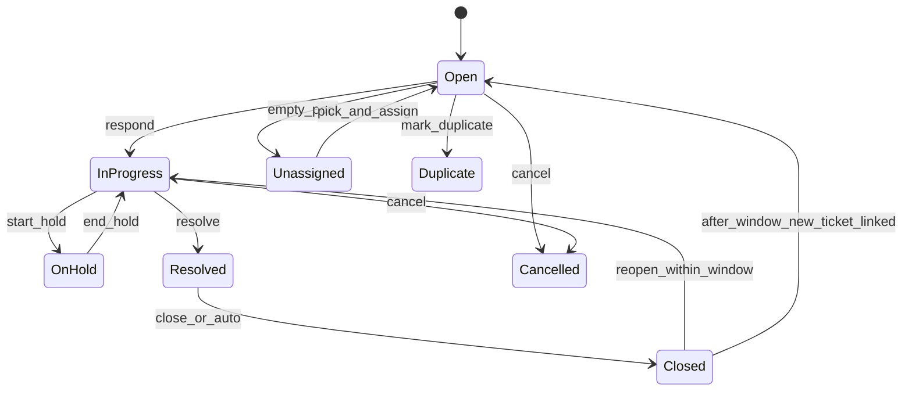

# PropDesk Low-Level Design (revised)

**Audience:** backend engineers implementing FastAPI, Postgres ticket engine, and workers.  
**Companions:** [SCHEMA.md](../SCHEMA.md), [schema.sql](../schema.sql), [schema_tests.sql](../schema_tests.sql), [LOAD_TEST.md](LOAD_TEST.md).  
**Revision:** Incorporates platform decisions on tenancy (RLS), worker reliability, AI routing, state model, API/auth scope, and NFRs. Composite FKs, `ticket_assignments` as Ownership history, immutable published chains, SKIP LOCKED + outbox, and AI corrections on the prediction row are unchanged.

---

## 1. System context

| Layer | Choice |
|---|---|
| Client | Next.js App Router UI |
| API | FastAPI — session → tenant, idempotency keys, error-code map (in scope) |
| Database | PostgreSQL 16+, **shared schema + RLS** (default); dedicated DB later as paid tier |
| Async work | Timer + outbox workers (claim/act/consume in one transaction) |

### 1.1 Tenancy (platform position vs IMS)

| | PropDesk | IMS (contrast) |
|---|---|---|
| Isolation | One shared database; every tenant row has `enterprise_id`; **RLS** + composite FKs | One database (or cluster) per customer |
| Session | API sets `SET LOCAL app.enterprise_id` once per transaction from verified JWT/session | Connection / DB name selects the customer |
| Cross-tenant refs | Composite FKs reject links to another company’s keys | Physically impossible across DBs |
| Cross-tenant access | RLS + engine `assert_enterprise()`; DEFINER functions pin `search_path` and read session tenant | Separate credentials |
| Paid upgrade | Dedicated database tier (later) for customers who require physical isolation | Default |

**Why shared + RLS:** operational cost and schema evolution at 50 enterprises; composite FKs alone stop bad *references*, not bad *access* through `SECURITY DEFINER` with a caller-supplied `p_enterprise_id`.

**Contract**

1. API authenticates → resolves `enterprise_id` → `SET LOCAL app.enterprise_id = '<uuid>'` (transaction-local).
2. Every tenant table has RLS `USING` / `WITH CHECK` on `enterprise_id = current_setting('app.enterprise_id')::uuid`.
3. Engine functions call `assert_enterprise()` (or take no enterprise param and use session only). Passing a mismatched `p_enterprise_id` raises.
4. All `SECURITY DEFINER` functions set `search_path` to `public` (or a fixed schema list) to block search_path attacks.

### 1.2 Sample story (acceptance)

Heating at The Foundry 4B / Maya Patel (L-10482): create → async AI → Dana primary / Marcus backup → Dana busy or decline → Marcus → both out → Unassigned → escalate (work status unchanged; escalation fields set) → acknowledge → skill pool → accept → resolve → close. Executable in [schema_tests.sql](../schema_tests.sql).

### 1.3 Non-functional targets

| Metric | Target |
|---|---|
| Volume | 50 enterprises × 500 tickets/day = **25,000 tickets/day** |
| Concurrent staff users | 500 across the fleet (design assumption for connection pool / worker sizing) |
| Create ticket p95 (excluding AI wait) | **&lt; 500 ms** |
| Route / `pick_and_assign` p95 | **&lt; 300 ms** |
| Worker poll interval | **5 s** |
| Max timer/outbox lag | **&lt; 30 s** (15-minute respond SLA remains ≥ 14.5 minutes of useful window) |

Load-test plan: [LOAD_TEST.md](LOAD_TEST.md).

---

## 2. Module map



Same table inventory as SCHEMA.md; additions called out in §3 and schema comments (RLS, `cancelled_at`, escalation fields, AI mode columns, scopes).

---

## 3. Canonical enums and fields

| Concept | Values |
|---|---|
| Priority | `Urgent`, `High`, `Normal`, `Low` |
| Availability | `Available`, `On call`, `Unavailable` |
| **Work status** | `Open`, `In Progress`, `On Hold`, `Unassigned`, `Resolved`, `Closed`, `Cancelled`, `Duplicate` — **no `Escalated`** |
| Escalation state | `none`, `waiting`, `acked` (on ticket: `escalation_level`, `escalation_state`) |
| Assignment reason | `initial_route`, `declined`, `busy`, `reassign`, `escalate_ack`, `import` |
| AI routing mode | `auto`, `human_review` (enterprise default; copied onto each `ai_predictions` row) |
| Permission keys | `view`, `create`, `edit`, `delete`, `reassign`, `config`, `users`, `billing`, **`accept`**, **`decline`**, **`busy`**, **`respond`**, **`resolve`** |
| Outbox status | `pending`, `processing`, `done`, `failed`, **`dead`** |
| Timer kinds | `level_respond`, `level_resolve`, `tenant_respond`, `tenant_resolve`, `at_risk`, `hold_limit`, `auto_close`, `escalation_ack`, **`busy_until`** |

Skills always match by **`category_id`**, never by name string.

---

## 4. Domain workflows

### 4.1 Create ticket



**Writes (sync path — never waits on frontier API)**

1. Insert `tickets` (work status `Open` or pending triage flag); link portfolio rows.
2. Insert issue `ticket_comments`.
3. Enqueue `outbox_events` kind `ai_enrich` with dedupe key; return ticket id to client.
4. If import of an **open** ticket: `apply_ticket_policy` from import time. If **closed** historical import: `is_imported` / skip clocks (unchanged).

**Async AI path:** see §8. Timeout (`enterprise_settings.ai_timeout_seconds`) → triage; does not block create.

### 4.2 Skill routing (Ownership)

**Algorithm**

1. Take advisory lock `hashtext(enterprise_id || category_id)` **or** `SELECT … FOR UPDATE` on candidate `users` rows in the skill pool.
2. Candidates: `user_skills.category_id = ticket.category_id`, not in `tickets.declined_user_ids`, property coverage, `status = active`, availability ∈ {Available, On call}.
3. Order by maintained `open_ticket_count` ASC, `last_assigned_at` ASC NULLS FIRST.
4. Primary = first; backup = second; else Unassigned.
5. Write `ticket_assignments`; adjust `open_ticket_count` (+1 primary on assign, −1 on release/resolve as defined in engine).

**Declined set:** only `tickets.declined_user_ids` (explicit array). Do not infer declines solely from assignment reasons.

**Freeze:** after accept (`In Progress`), decline/busy rejected until escalate or `reassign`.

### 4.3 Decline / Busy



| Action | Side effects |
|---|---|
| Decline | Append to `declined_user_ids`; re-route; do not change global availability |
| Busy | `Unavailable` + `busy_until` (user-chosen duration); absence/timer restores `Available`; re-route |

### 4.4 Work state + escalation (separate)



Escalation is **orthogonal**: `escalation_state` ∈ {none, waiting, acked}, `escalation_level` int. An `In Progress` or `On Hold` ticket keeps its work status when escalated.

**Guards**

- `resolve_ticket` fails if `escalation_state = waiting`, or no primary, or `Unassigned` / `Cancelled` / `Duplicate`.
- Escalation never sets work status to Resolved.
- Acknowledge: `escalation_state = acked` → `none`, level 0, re-route; **anti-loop:** same user cannot ack and immediately re-trigger the same level without a state change / cooldown event recorded.
- Last chain level: notify Super/Regional; stay `waiting`; do not invent further levels.
- Reopen Closed within `reopen_days`; after window → create new ticket with `follow_up_of = original`.

### 4.5 Escalation ladder

Unchanged chain resolution (`resolve_chain`); published chains immutable when referenced. Level timers + `escalation_ack` worker path. Severity rules may skip levels.

### 4.6 SLA clock

```
respond_mins = category.respond_mins * priority_rules.multiplier
resolve_mins = category.resolve_mins * priority_rules.multiplier
```

Heating Urgent example: 60×0.25 → **15m** respond; 480×0.25 → **2h** resolve.

- Each **property calendar** has a **timezone**; business-minute helpers convert with DST awareness.
- Mid-ticket category/priority change: recompute deadlines from **now** with the new policy (elapsed pause totals retained); emit `ticket_events` + audit-style payload.
- Reopen: new `clock_started_at = now()`; re-apply policy.
- Holds: by default pause **tenant SLA only**; level timers keep running unless `hold_reasons.pauses_level_timers`.
- Persist `respond_breached_at`, `resolve_breached_at` (and boolean flags) on the ticket when breaches fire — reporting must not recompute breach history.
- Open imports: arm SLA from import time. Closed historical imports: no clocks.

---

## 5. Ticket engine — function contracts

All mutating engine functions: `SECURITY DEFINER`, pinned `search_path`, call `assert_enterprise()`, append `ticket_events`, enqueue outbox with dedupe keys, cancel obsolete timers (`cancelled_at`) instead of leaving handlers to ignore them.

| Function | Notes |
|---|---|
| `assert_enterprise()` | Session `app.enterprise_id` required |
| `next_ticket_number` | Counter bump |
| `resolve_sla_policy` / `resolve_chain` | Rule lookup |
| `add_business_minutes` / `business_minutes_between` | TZ + DST via calendar timezone |
| `apply_ticket_policy` | Tenant SLA + timers; open imports OK; closed imports no-op |
| `enter_level` / `assign_level` / `pick_and_assign` | Pool lock; maintained open counts |
| `respond_to_ticket` | Requires `accept`/`respond` permission at API layer |
| `decline_assignment` / `mark_assignee_busy(duration)` | Explicit declined set; busy_until |
| `start_hold` / `end_hold` | Tenant vs level pause flags |
| `escalate_ticket` / `acknowledge_escalation` | Escalation fields only; anti-loop |
| `resolve_ticket` / `reopen_ticket` / `close_ticket` | Reopen window vs follow-up ticket |
| `claim_due_timer` / `consume_timer` | Same transaction as handler act |
| `record_event` / `enqueue_outbox` | Append-only events; deduped outbox |

---

## 6. Background worker

### 6.1 Timer loop (reliability)

In **one transaction**:

1. `SELECT … FOR UPDATE SKIP LOCKED` due timers where `consumed_at IS NULL AND cancelled_at IS NULL AND fires_at <= now()`.
2. Re-read ticket; if state makes the timer obsolete → set `cancelled_at`, commit, stop.
3. Else act (idempotent: outbox/event `dedupe_key` includes `timer_id`).
4. Set `consumed_at = now()` in the **same** transaction.

Never escalate twice from the same timer: second claim sees `consumed_at` or `cancelled_at`.

State changes that invalidate timers call `cancel_timers(ticket_id, kinds[])` setting `cancelled_at`.

### 6.2 Outbox

| Field | Role |
|---|---|
| `dedupe_key` | Unique per enterprise for email/in-app (e.g. `notify:{ticket_id}:{event_type}:{timer_id}`) |
| `attempts` / `next_attempt_at` | Exponential back-off |
| `status = dead` | After N attempts (default 8) |

**Notifications vs outbox:** `outbox_events` is the work queue. Notify handlers insert `notifications` (user inbox) and send email. Do not treat `notifications` as the queue.

### 6.3 Lag budget

Poll every **5s**; target max lag **&lt; 30s**. For a 15-minute respond SLA, worst-case detection still leaves ≥ 14.5 minutes — acceptable. Scale with more poller processes sharing SKIP LOCKED (no sticky timer ownership).

### 6.4 Deployment

- Stateless poller replicas (timers + outbox).
- Horizontal scale; each replica uses SKIP LOCKED.
- Health: lag metric = `now() - min(fires_at)` for unconsumed due rows.

---

## 7. Permissions and scopes

| Permission | Typical roles |
|---|---|
| `view`, `create` | all |
| `edit`, `reassign` | Super, Regional, T1, T2 |
| `accept`, `decline`, `busy`, `respond`, `resolve` | Type 3 (on own primary tickets) + higher tiers as configured |
| `config`, `users` | Super, Regional (scoped) |
| `billing` | Super |

**Region / property scope:** `user_region_scopes` / existing `user_properties` limit which tickets a Regional Admin or scoped role may see and mutate. API filters + RLS helpers using session `app.user_id` where needed.

---

## 8. AI enrichment

- **Hosting:** frontier model API under DPA; **redact** names, lease numbers, unit ids, phones, emails before send.
- **Modes** (`enterprise_settings.ai_routing_mode`), copied to `ai_predictions.routing_mode`:
  - **Auto:** confidence ≥ threshold → apply category/priority (within raise cap) → `pick_and_assign`; below → triage.
  - **Human review:** store suggestions only; coordinator confirms → then policy + route.
- Store `model_name`, `prompt_version`, confidence, corrections on the row.
- **Priority raise cap:** AI may raise at most N steps (enterprise setting, default 1) from a baseline; all AI-driven priority changes logged on `ticket_events`.
- **Non-leaf category:** treat as triage / force human confirm; do not route on non-leaf.
- Create path never blocks; timeout → triage.

---

## 9. Reporting, migration, histories

| Store | Authority | Mutability |
|---|---|---|
| `ticket_assignments` | Who held the ticket (Ownership) | Append; release via `released_at` |
| `ticket_events` | Operational timeline | **Append-only** (DB trigger blocks UPDATE/DELETE) |
| `audit_log` | Config/settings changes | **Append-only** |

Imports: open tickets get SLA from import time; closed historical skip clocks.

### 9.1 DPDPA erasure

On tenant data request: anonymise/erase PII on `tenants`, comments, notifications; replace names with tokens; **retain** `ticket_events` / `audit_log` with scrubbed payloads so the audit trail remains. Soft delete alone is insufficient.

### 9.2 Volume

Partial indexes: `ticket_timers(fires_at) WHERE consumed_at IS NULL AND cancelled_at IS NULL`; outbox pending by `next_attempt_at`. Time-partition `ticket_events`, `outbox_events`, `audit_log` (monthly) sized for 25k tickets/day.

---

## 10. API, auth, errors (in scope)

### 10.1 Session → tenant

1. Verify access token.
2. Load user → `enterprise_id` (+ scopes).
3. Begin transaction; `SET LOCAL app.enterprise_id`; optional `SET LOCAL app.user_id`.
4. Call engine; commit.

### 10.2 Idempotency

Mutating endpoints accept `Idempotency-Key`. Persist key → response for 24h per enterprise; replays return the first result without double-assign.

### 10.3 Error-code map (engine → HTTP)

| Engine condition | API code | HTTP |
|---|---|---|
| Missing/wrong `app.enterprise_id` | `TENANT_CONTEXT` | 403 |
| Cross-tenant / RLS | `TENANT_ISOLATION` | 403 |
| Resolve while escalation waiting | `ESCALATION_OPEN` | 409 |
| No primary / Unassigned resolve | `NO_ASSIGNEE` | 409 |
| Handoff frozen after accept | `HANDOFF_FROZEN` | 409 |
| Published chain edit | `CHAIN_IMMUTABLE` | 409 |
| Reopen window expired | `REOPEN_EXPIRED` | 409 |

---

## 11. Traceability

| Surface | Design home |
|---|---|
| Ticket Rep / Walkthrough sample | §1.2, §4, schema_tests |
| Ownership board | §4.2 `ticket_assignments` |
| RLS vs IMS | §1.1 |
| Worker lag / 15m SLA | §6.3 |
| AI Auto vs Human review | §8 |
| Load 25k/day | [LOAD_TEST.md](LOAD_TEST.md) |
